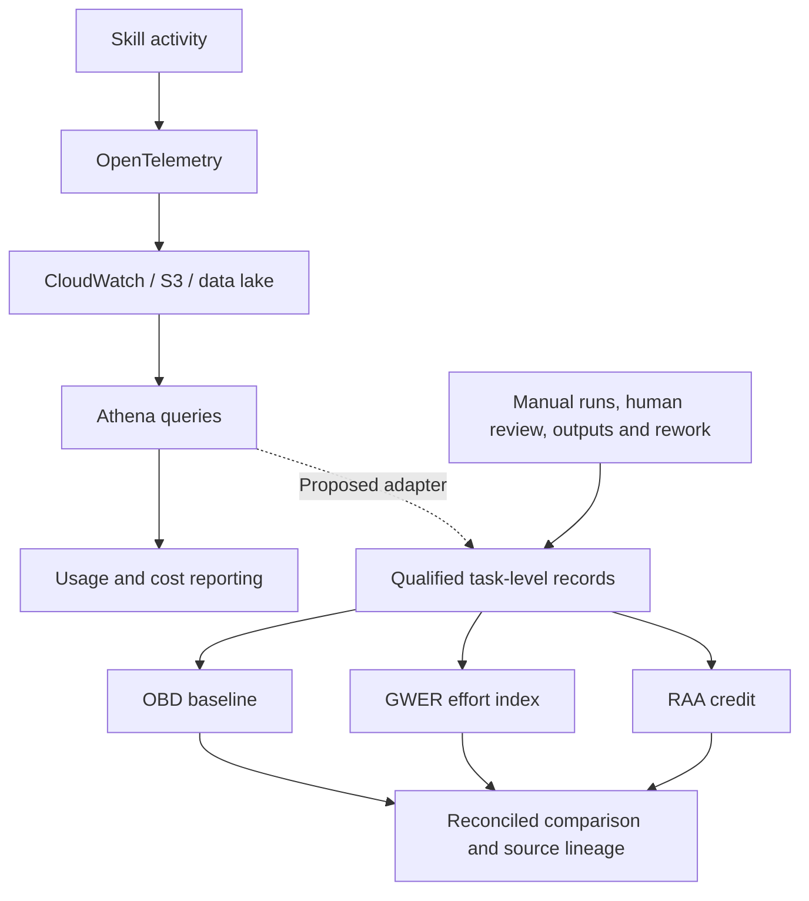

# Telemetry to measurement

The upstream pipeline is integration context. This repository implements local synthetic fixtures and calculation tools; it does not connect to enterprise systems.

The handoff requires event, run, workflow/version, task and actor IDs; timestamps; status; source pointers; human active intervals; linked resources; artifact revisions; accepted quality; approved rates; and billed AI costs. Preserve query versions and exclusions. Session time and token counts alone cannot establish displaced human work.

The controller executes input inspection, baseline discovery, graph reconstruction, credit adjustment and comparison. Tool observations drive the deterministic next step. It stops when the manual baseline is inadequate. An LLM planner is a possible future extension, not a dependency or feature of this implementation.

Input hashes identify calculation inputs. They do not authenticate collection or prove historical adoption.
